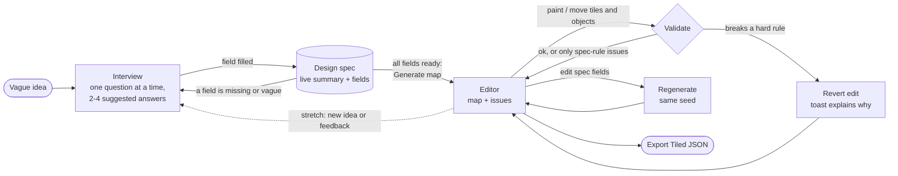
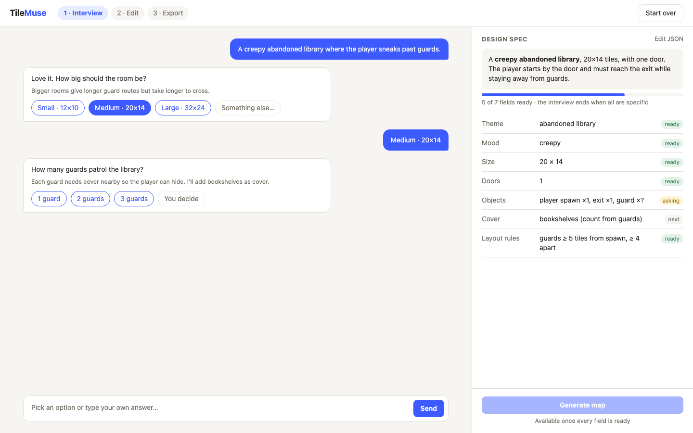
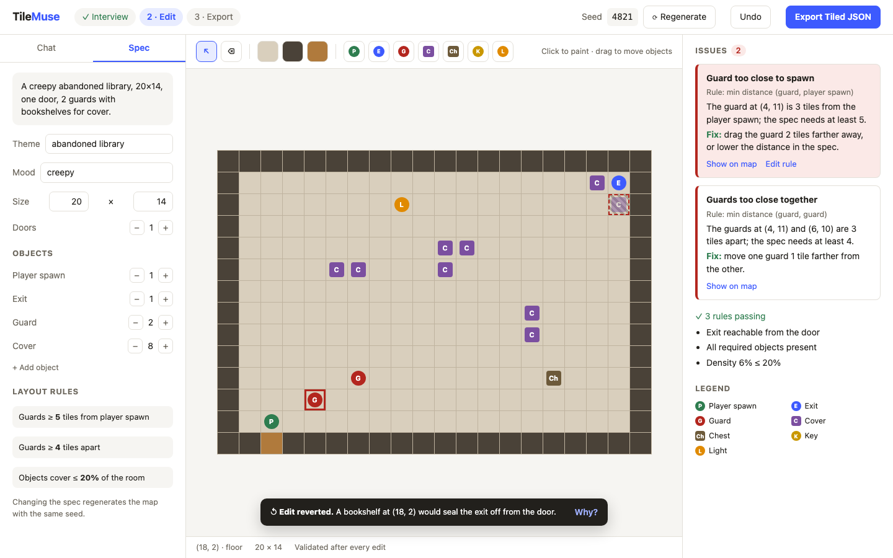

# UI draft and mockup

Main user flow and screen layout for the MVP (issue #8). The mockups are a direction, not a pixel spec.

## User flow



1. **Idea.** The user types a rough idea into the chat.
2. **Interview.** The agent asks about the most important missing or vague field. Each question has 2-4 suggested answers, a one-line reason in plain language, and a free-text option. The design spec panel fills in live.
3. **Generate.** "Generate map" unlocks once every field is ready. The backend generates with a seed and validates.
4. **Edit.** The user paints tiles and places objects. Validation runs after every edit. Changing spec fields regenerates the map with the same seed.
5. **Export.** "Export Tiled JSON" downloads a `.tmj` file for Tiled, Phaser, or Godot.

## Screens

### 1. Interview



- **Chat (left).** Agent questions show suggested-answer chips. The chosen chip is echoed as the user's reply. "Something else…" or the composer lets the user answer in their own words.
- **Design spec (right).** A plain-English summary at the top, then one row per required field with a status: `ready`, `asking`, or `next`. The progress bar shows how close the interview is to done.
- **Generate map** stays disabled until every field is ready. "Edit JSON" opens the raw spec for power users.

### 2. Editor



- **Top bar.** The seed and Regenerate (a new seed means a new layout for the same spec), Undo, and the primary **Export Tiled JSON** action.
- **Left rail.** Tabs for Chat and Spec. The Spec tab edits the same fields as the interview: size, doors, object counts, and layout rules.
- **Center.** A tool palette (select, erase, floor, wall, door, and one tool per object kind), the map canvas, and a status bar with the hovered tile.
- **Issues (right).** One card per violation, with the rule, the explanation from the explainer, and a suggested fix. "Show on map" highlights the tile (the red outline on the guard). Passing rules are listed below so the user knows what was checked.
- **Toast.** An edit that would break a hard rule is reverted immediately and explained. Here, a bookshelf (shown dashed) would have sealed off the exit.

## Design decisions

- **Two kinds of problems, two treatments.** Hard rules (exit reachable from the door, required objects present) make an unplayable map, so a breaking edit is reverted with a toast, as the proposal's "reject invalid changes and revert" asks. Spec rules (`min_distance`, `max_density`) are listed as issues the user can fix or accept, since fixing them may take several moves.
- **The spec stays visible.** It is a side panel in the interview and a tab in the editor, so it is the single source of truth the user can always see and edit.
- **Choices over open questions.** Every interview question offers 2-4 concrete answers, for users without design training.
- **Explanations come from the explainer.** Issue text and fixes come from its templates, so the UI never invents violations.

## Open questions

- Should "Apply fix" exist for spec-rule issues, or only "Show on map"? An automatic fix would need a new deterministic fixer and is likely post-MVP.
- Does editing the map (for example, adding a third guard) update the spec's object counts, or only flag a mismatch? The proposal says "change spec settings accordingly".
- Export step: a direct download (as drawn) or a small dialog with format notes and a Phaser snippet?

## Updating the mockups

The PNGs are rendered from [`ui/mockup.html`](ui/mockup.html). Edit it, open `mockup.html?screen=interview` or `?screen=editor` in a browser, and take a 1440×900 screenshot. With Chrome headless:

```sh
chrome --headless=new --window-size=1440,900 --hide-scrollbars \
  --screenshot=docs/ui/editor.png "file://$PWD/docs/ui/mockup.html?screen=editor"
```
